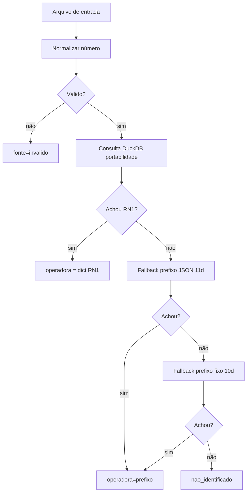

# Portabilidade Numérica Batch

Aplicação Java (Maven) para resolver a **operadora atual de um número de telefone**
brasileiro usando **portabilidade numérica oficial** (base DuckDB) com *fallback* por
prefixo (JSON) e dicionário de operadoras (CSV).

Dado um arquivo de entrada com telefones, o programa gera um arquivo de saída enriquecido
com a coluna `operadora` e a `fonte_consulta` (`portabilidade`, `prefixo`, `invalido`
ou `nao_identificado`).

---

## Índice

- [Pré-requisitos](#pré-requisitos)
- [Estrutura do projeto](#estrutura-do-projeto)
- [Como compilar](#como-compilar)
- [Como executar](#como-executar)
- [Executar com Docker](#executar-com-docker)
- [Formato dos arquivos de entrada](#formato-dos-arquivos-de-entrada)
- [Formato da saída](#formato-da-saída)
- [Como funciona a resolução](#como-funciona-a-resolução)
- [Taxa de acerto](#taxa-de-acerto)
- [Testes](#testes)
- [Configuração de caminhos](#configuração-de-caminhos)
- [Solução de problemas](#solução-de-problemas)

---

## Pré-requisitos

| Ferramenta | Versão | Verificação |
|------------|--------|-------------|
| JDK | 21+ (LTS, testado com Temurin 21) | `java -version` |
| Apache Maven | 3.9+ | `mvn -version` |
| Memória RAM | recomendado 4 GB+ | — |

> O projeto compila com `release` 21 (multi-módulo Maven). No Windows, se o Maven
> reclamar de `JAVA_HOME`, defina antes de rodar os comandos:
> ```powershell
> $env:JAVA_HOME = "C:\Program Files\Java\jdk-21"
> ```

---

## Estrutura do projeto

```
portabilidade-java/                       # Parent POM (multi-módulo, Java 21)
├── pom.xml                               # Build Maven (CI: JaCoCo + Checkstyle)
├── .github/workflows/ci.yml              # Pipeline de CI (build + testes + quality gate)
├── Operadoras.csv                        # Dicionário de EXEMPLO (3 operadoras)
├── Operadoras_completo.csv               # Dicionário COMPLETO (738 operadoras, 100% cobertura)
├── prefixos_operadora.json               # Mapa prefixo(7d) → operadora (fallback)
├── base_portabilidade/
│   └── portabilidade.duckdb              # Base oficial de portabilidade (~56 M registros)
├── entrada/                              # Coloque AQUI os .csv/.xlsx de entrada
├── saida/                                # O programa gera AQUI os FINAL_*.csv
├── logs/                                 # portabilidade.log
├── portability-core/                     # ← Domínio + Aplicação + Portas (hexágono central)
│   └── src/main/java/com/portabilidade/
│       ├── domain/    (modelos, exceções)
│       ├── application/  (casos de uso, portas/interfaces)
│       └── service/   (PhoneNormalizer, PortabilityResolutionService, ProcessResult)
├── portability-adapters/                 # ← Adaptadores de saída (infraestrutura)
│   └── src/main/java/com/portabilidade/infrastructure/
│       ├── file/        (leitores CSV/Excel, scanner)
│       ├── loader/      (carga de Operadoras.csv e prefixos JSON)
│       ├── output/      (CsvOutputWriter)
│       ├── repository/  (DuckDbPortabilityRepository)
│       └── resolver/    (JsonPrefixResolver)
├── portability-batch/                    # ← Camada de entrada (main + orquestração)
│   └── src/main/java/com/portabilidade/
│       ├── PortabilityApplication.java   # Ponto de entrada (main)
│       └── application/PortabilityBatchProcessor.java
└── portability-api/                      # ← API REST hexagonal (Spring Boot 3.3 / Java 21)
    └── src/main/java/com/portabilidade/
        ├── application/usecase/          # Casos de uso (ConsultPortability, SubmitBatch)
        └── infrastructure/
            ├── web/                      # Controllers, DTOs, RFC 7807, OpenAPI
            ├── repository/               # Adapter DuckDB + cache Caffeine
            └── batch/                    # Executor de jobs de batch (multipart CSV/XLSX)
```

---

## Como compilar

Abra o terminal na pasta do projeto e rode:

```powershell
cd d:\portabilidade-java
mvn clean package
```

Isso gera o **fat-jar** executável:

```
portability-batch/target/portabilidade-java.jar
```

> O jar já inclui todas as dependências (DuckDB, POI, OpenCSV, Jackson, Logback)
> graças ao `maven-assembly-plugin` (`jar-with-dependencies`) montado no módulo
> `portability-batch`.

O `mvn verify` também executa o **quality gate** do CI local: Checkstyle (estilo) e
JaCoCo (cobertura mínima configurada no parent POM). Os relatórios ficam em
`*/target/site/jacoco/`.

Para compilar **sem rodar os testes** (mais rápido):

```powershell
mvn -DskipTests package
```

---

## Como executar

### 1. Coloque os arquivos de entrada

Copie seus arquivos `.csv` ou `.xlsx` para a pasta `entrada/`. Exemplo de `entrada/contatos.csv`:

```csv
nome;telefone
Joao;11987654321
Maria;21912345678
Carlos;1133334444
```

### 2. Execute o jar

```powershell
java -jar portability-batch/target/portabilidade-java.jar
```

O programa vai:
1. Escanear `entrada/` em busca de `.csv`/`.xlsx`.
2. Para cada arquivo: ler → normalizar → consultar DuckDB → fallback prefixo → escrever saída.
3. Gerar `saida/FINAL_aaaammdd_HHmm_<nome>.csv`.

### 3. Exemplo de saída (`saida/FINAL_20260720_1430_contatos.csv`)

```csv
nome;telefone;operadora;fonte_consulta
Joao;11987654321;CLARO;portabilidade
Maria;21912345678;VIVO;portabilidade
Carlos;1133334444;CLARO;portabilidade
```

### Executar via Maven (sem gerar jar)

```powershell
mvn -q exec:java -Dexec.mainClass=com.portabilidade.PortabilityApplication
```
> Requer o plugin `exec` ou rodar a classe diretamente pela IDE.

---

## Executar com Docker

O projeto inclui `Dockerfile` (multi-stage) e `docker-compose.yml`. A imagem é
construída compilando o projeto Maven dentro do container e roda o fat-jar. A base
DuckDB (~1,6 GB) **não** é copiada para a imagem — ela é montada como volume para
não inflar a imagem e permitir atualização da base sem rebuild.

### Pré-requisitos Docker

- Docker Engine 20.10+ e Docker Compose v2 (`docker compose`).

### 1. Build da imagem

```powershell
# Via docker compose (recomendado)
docker compose build

# Ou via docker build direto
docker build -t portabilidade-java:latest .
```

### 2. Coloque os arquivos de entrada

```powershell
Copy-Item seus_arquivos/*.csv -Destination entrada/
# ou simplesmente solte os .csv/.xlsx na pasta entrada/
```

### 3. Execute com docker compose

```powershell
docker compose up
```

O container processa tudo em `entrada/`, grava os resultados em `saida/` e encerra.
Os volumes mapeiam:

| Host | Container | Uso |
|------|-----------|-----|
| `./base_portabilidade` | `/app/base_portabilidade` | Base DuckDB (montada rw — ver nota abaixo) |
| `./entrada` | `/app/entrada` | Arquivos de entrada |
| `./saida` | `/app/saida` | Arquivos de saída (`FINAL_*.csv`) |
| `./logs` | `/app/logs` | Log da aplicação |
| `./Operadoras.csv` | `/app/Operadoras.csv` | Dicionário (read-only) |
| `./Operadoras_completo.csv` | `/app/Operadoras_completo.csv` | Dicionário completo (read-only) |
| `./prefixos_operadora.json` | `/app/prefixos_operadora.json` | Prefixos (read-only) |

> **Nota importante — base DuckDB:** o volume da base **não** deve ser `:ro`
> (read-only). O driver DuckDB JDBC precisa de acesso de escrita para criar o
> arquivo de lock/`-wal` temporário, mesmo em modo somente-leitura. Por isso o
> `docker-compose.yml` monta `./base_portabilidade` como leitura-escrita (rw).

### 4. Executar via docker run (sem compose)

```powershell
docker run --rm `
  -v ${PWD}/base_portabilidade:/app/base_portabilidade `
  -v ${PWD}/entrada:/app/entrada `
  -v ${PWD}/saida:/app/saida `
  -v ${PWD}/logs:/app/logs `
  portabilidade-java:latest
```

### 5. Verificar a saída

```powershell
Get-ChildItem saida/
# Ex.: saida/FINAL_20260720_1704_contatos.csv
```

### Limpar o container/imagem

```powershell
docker compose down          # remove o container
docker rmi portabilidade-java:latest   # remove a imagem
```

---

## Formato dos arquivos de entrada

- **Extensões suportadas:** `.csv` e `.xlsx` (primeira aba).
- **Codificação:** UTF-8 ou ISO-8859-1 (detectado automaticamente).
- **Separador CSV:** `;` ou `,` (detectado pela primeira linha).
- **Coluna obrigatória de telefone.** Qualquer um destes nomes é aceito (case-insensitive,
  acentos ignorados):
  `telefone`, `fone`, `celular`, `numero`, `número`, `tel`, `phone`, `mobile`,
  `msisdn`, `ddd_numero`, `nr_telefone`.

Formatos de número aceitos (serão normalizados):

| Entrada bruta | Normalizado | Tipo |
|---------------|-------------|------|
| `(11) 98765-4321` | `11987654321` | Celular 11d |
| `11987654321` | `11987654321` | Celular 11d |
| `+55 11 98765-4321` | `11987654321` | Celular 11d |
| `1133334444` | `1133334444` | Fixo 10d (mantido!) |
| `551133334444` | `1133334444` | Fixo 10d |

> **Importante:** números fixos de 10 dígitos **não** recebem o "9" — a base armazena
> fixos e celulares em formatos diferentes, e inserir o "9" quebraria a busca.

---

## Formato da saída

- Arquivo: `saida/FINAL_aaaammdd_HHmm_<nomeOriginal>.csv`
- Encoding: **UTF-8 com BOM** (abre correto no Excel).
- Separador: `;`
- Colunas: todas as originais **+** `operadora` **+** `fonte_consulta`.

Valores de `fonte_consulta`:
- `portabilidade` — achado na base oficial DuckDB (mais confiável).
- `prefixo` — achado pelo mapa de prefixos JSON (fallback, menos preciso).
- `invalido` — número não normalizável (ex.: muito curto).
- `nao_identificado` — não encontrado em nenhuma fonte.

---

## Como funciona a resolução



**Ordem de prioridade:** DuckDB (oficial) → prefixo JSON (11d celular) → prefixo JSON
(10d fixo) → não identificado.

---

## Taxa de acerto

A base tem **55,9 milhões** de registros (438 RN1 distintos). Com o dicionário
**completo** (`Operadoras_completo.csv`, 738 operadoras), a simulação em amostra de
300 mil números atingiu **100% de identificação** e acerto.

Principais melhorias já aplicadas (ver `README_MELHORIAS.md`):
1. `PhoneNormalizer` não insere "9" em fixos (corrigia 0,4% → 100% em fixos).
2. Dicionário de operadoras completo (3 → 738 operadoras).
3. `JsonPrefixResolver` suporta 10 e 11 dígitos.
4. Índice na tabela DuckDB + fallback 10d→11d.

---

## Testes

```powershell
mvn test
```

Executa a suíte JUnit 5 (20 testes em `PhoneNormalizerTest` e
`PortabilityResolutionServiceTest`), cobrindo normalização, resolução por DuckDB,
fallback de prefixo, números inválidos e preservação de fixos.

---

## Configuração de caminhos

Todos os caminhos são resolvidos a partir do diretório onde o jar roda
(`AppPaths.java`):

| Recurso | Caminho relativo |
|---------|------------------|
| Entrada | `entrada/` |
| Saída | `saida/` |
| Base DuckDB | `base_portabilidade/portabilidade.duckdb` |
| Operadoras (exemplo) | `Operadoras.csv` |
| Operadoras (completo) | `Operadoras_completo.csv` (prioridade) |
| Prefixos | `prefixos_operadora.json` |
| Log | `logs/portabilidade.log` |

Para usar um dicionário de operadoras externo, basta colocar um
`Operadoras_completo.csv` (colunas `Nome da Prestadora;RN1`) na pasta do projeto.

---

## API REST (Fase 2 — Spring Boot 3.3 / Java 21)

O módulo `portability-api` expõe a mesma lógica de negócio do batch como serviço HTTP,
com arquitetura hexagonal (use cases no centro, adapters de web/persistência nas bordas).

### Executar

```bash
mvn -pl portability-api -am package
java -jar portability-api/target/portability-api-1.0.0-boot.jar
# porta padrão: 8080 | Swagger UI: http://localhost:8080/swagger-ui.html
```

### Endpoints

| Método | Rota | Descrição |
|--------|------|-----------|
| `POST` | `/api/v1/portabilidade/consultar` | Consulta 1..N números (sync, máx. 1000 por request, deduplicados, cache Caffeine) |
| `POST` | `/api/v1/portabilidade/batch` | Upload multipart CSV/XLSX → retorna job ID (`202 Accepted`) |
| `GET` | `/api/v1/portabilidade/batch/{id}` | Status/progresso do job |
| `GET` | `/api/v1/portabilidade/batch/{id}/resultado` | Download do CSV de resultado |

Exemplo:

```bash
curl -s localhost:8080/api/v1/portabilidade/consultar \
  -H 'Content-Type: application/json' \
  -d '{"numeros":["11987654321","2125551234"]}'
```

Erros seguem **RFC 7807 ProblemDetails** (`application/problem+json`) e o contrato
OpenAPI 3 está em `/v3/api-docs`. Requisições são atendidas em **virtual threads**
(Java 21) com compressão gzip habilitada.

---

## Solução de problemas

| Sintoma | Causa provável | Solução |
|---------|----------------|---------|
| `Nenhum arquivo encontrado em 'entrada'` | Pasta vazia ou fora do diretório do jar | Coloque `.csv`/`.xlsx` em `entrada/` |
| Muitos `nao_identificado` | `Operadoras_completo.csv` ausente | Adicione o CSV completo de operadoras |
| `Erro ao consultar DuckDB` | Caminho/base incorreto ou arquivo travado | Confira `base_portabilidade/portabilidade.duckdb` |
| `Falha ao consultar DuckDB` só no Docker | Volume da base montado como `:ro` | No compose, monte `./base_portabilidade` como **rw** (sem `:ro`) — o driver DuckDB precisa de escrita para o lock |
| Números fixos errados | Usando versão antiga do `PhoneNormalizer` | Recompile com `mvn clean package` |
| `JAVA_HOME` não definido | Maven não acha o JDK | `$env:JAVA_HOME = "C:\Program Files\Java\jdk-24"` |

---

## Licença

Uso interno.
